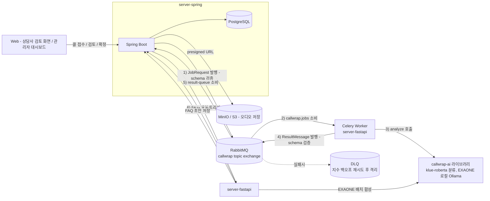

# CallWrap — Backend (server-spring)

장애인활동지원 상담센터의 상담 후처리 업무를 자동화하는 데이터/오케스트레이션 서버입니다.

상담사가 통화 종료 후 수기로 작성하던 요약, 상담 분류, 등급 산정, 후속 조치 여부 판단 등의 과정을 AI 파이프라인이 초안으로 생성합니다. 상담사는 생성된 결과를 검토·수정하여 간편하게 확정할 수 있으며, 반복되는 문의를 모아 FAQ 지식베이스를 자동 축적합니다. 이를 통해 상담사의 반복 업무 부담을 줄이고 상담 데이터를 구조화된 형태로 표준화하는 것을 목표로 합니다.

이 레포지토리는 시스템의 4개 핵심 저장소 중 Backend(Spring Boot) 를 담당합니다. 음성인식, 화자 분리, 분류 및 요약 등의 AI 연산은 직접 수행하지 않으며, 콜 접수, 사용자 인증, 파이프라인 오케스트레이션, 검토 워크플로우, 결과 저장 및 모니터링을 맡고 AI 연산은 server-fastapi에 비동기로 위임합니다.

| 저장소 | 역할 | 스택 |
|---|---|---|
| `server-spring` (이 레포) | 인증, 콜 접수·검토 API, 파이프라인 오케스트레이션, FAQ 검수 API, 상태·결과 영구 저장, 메트릭 노출 | Spring Boot 3.5, Java 21, PostgreSQL |
| `server-fastapi` | Celery 워커 — 전사(STT)·화자분리·품질게이트·AI분석 실행을 오케스트레이션, FAQ 배치 생성 트리거 처리 | FastAPI, Celery, RabbitMQ |
| `AI-model` (`callwrap-ai`) | 실제 AI 연산 라이브러리 — 분류(klue-roberta), 상담등급·요약·후속처리·FAQ필요여부(EXAONE, 로컬 Ollama) | Python 라이브러리, `server-fastapi`가 git 의존성으로 설치 |
| `web` | 상담사 검토 화면, 관리자 대시보드(FAQ 검수 포함) | TypeScript |

## 전체 아키텍처



콜이 접수되면 Spring이 `JobRequest`를 RabbitMQ에 발행하고 즉시 `202 Accepted`를 반환한다. Celery 워커(`server-fastapi`)가 전사→품질게이트→AI분석을 내부에서 전부 처리한 뒤 `ResultMessage`로 최종 결과만 돌려주면, Spring이 상태(`DONE` / `NEEDS_HUMAN_REVIEW` / `FAILED`)에 따라 분기해 저장한다. **Spring은 AI 모델을 직접 호출하지 않는다** — 큐를 사이에 둔 두 서비스가 완전히 비동기로 분리되어 있다.

Celery는 **RabbitMQ를 브로커로만 쓰고 result backend(Redis 등)는 쓰지 않는다.** 태스크 결과는 Celery 자체 메커니즘이 아니라, 각 태스크가 처리를 마친 뒤 직접 `ResultMessage`를 RabbitMQ에 발행하는 방식으로 Spring에 전달된다. 시스템 전체에 Redis는 어디에도 쓰이지 않는다.

### 콜 처리 상태 (6단계)

```
UPLOADED → PROCESSING → DONE / NEEDS_HUMAN_REVIEW / FAILED → CONFIRMED
```

`DONE`·`NEEDS_HUMAN_REVIEW`·`FAILED`는 파이프라인 결과에 따라 갈리고, 상담사가 검토를 마치면 `CONFIRMED`(종결)로 전이한다. `CONFIRMED`와 `FAILED`만 종결 상태다.

## server-spring이 담당하는 것

- **인증** — JWT 발급/재발급/로그아웃 (`counselor` 도메인)
- **콜 접수** — presigned URL 발급(오디오는 Spring을 거치지 않고 클라이언트가 스토리지에 직접 업로드) 후 `JobRequest` 발행, 즉시 202 반환
- **파이프라인 오케스트레이션** — RabbitMQ를 통한 비동기 Job 발행/결과 수신, 메시지 계약(JSON Schema) 검증, 장애 시 DLQ·재시도
- **검토 워크플로우** — AI 판정 결과 조회, 상담사 수정·확정(`confirm`)
- **FAQ 검수 파이프라인** — FAQ 후보 콜 집계 API 제공, FastAPI에 배치 생성 트리거, 생성된 FAQ 초안 저장·수정·게시·폐기 API 제공
- **상태·결과 영구 저장** — PostgreSQL(Flyway 스키마 관리), 전사·품질검증·AI분석 결과를 JSONB로 저장
- **운영 가시성** — Micrometer/Prometheus로 큐 적재량·처리 지연시간·발행/수신 건수 노출

## 핵심 기능

1. **비동기 파이프라인 오케스트레이션** — RabbitMQ topic exchange(`callwrap`) 기반. 콜 접수는 즉시 202로 응답하고, 실제 처리는 백그라운드에서 이뤄진다.
2. **메시지 계약 검증** — `JobRequest`/`ResultMessage` 둘 다 JSON Schema(Draft-07, `networknt/json-schema-validator`)로 발행 시점과 수신 시점 모두 검증한다. 위반 시 메트릭 카운터를 올리고 요청을 거부한다.
3. **장애 대응(DLQ + 재시도)** — `callwrap.jobs`(Job 큐), Spring의 result 큐 양쪽에 Dead Letter Exchange/Queue를 구성했고, Spring 리스너에는 지수 백오프 재시도(2s → 30s, 최대 4회)가 붙어 있다. 존재하지 않는 콜에 대한 결과 수신처럼 재시도해도 해결되지 않는 오류는 즉시 DLQ로 보낸다.
4. **콜 검토 워크플로우** — 상담사가 AI 판정을 검토·수정 후 확정한다. 확정 전까지는 자유롭게 수정 가능하고, 확정 이후 데이터는 엔티티 내부 메서드(`AnalysisResult.confirm()`)를 통해서만 바뀐다.
5. **FAQ 자동 생성** — "FAQ 반영 필요"(`needs_faq`)로 판정되고 아직 처리되지 않은 콜을 상담분류(소분류) 단위로 묶어 배치 생성을 트리거한다. FastAPI가 EXAONE으로 대표 질문·답변을 합성해 돌려주면 Spring이 `DRAFT` 상태로 저장하고, 상담사가 web에서 검수(수정/게시/폐기)한다.
6. **운영 가시성** — `/actuator/prometheus`에서 큐 적재량(Job 큐·Result 큐 모두, RabbitMQ Management API를 10초 주기로 폴링), Job 발행 건수, 결과 수신 건수(상태별), 처리 소요시간(p50/p95/p99), 스키마 위반 건수를 노출한다. Grafana 대시보드 시각화는 다음 단계.
7. **API 문서화** — springdoc-openapi 기반 Swagger UI, JWT bearer 인증 스킴 포함.
8. **부하 테스트** — `loadtest/`에 Locust/k6 기반 시나리오(콜 접수→처리 완료까지의 파이프라인 부하) 준비.
9. **실시간 갱신(SSE)** — 콜 상태가 바뀔 때마다(`PROCESSING`/`DONE`/`NEEDS_HUMAN_REVIEW`/`FAILED`/`CONFIRMED`) `/api/reviews/stream`으로 이벤트를 밀어줘서, 상담사 화면이 폴링 없이 대기열을 갱신한다. `@TransactionalEventListener(AFTER_COMMIT)`로 트랜잭션이 실제로 커밋된 뒤에만 내보낸다.
10. **관리자 대시보드 집계** — 상태별·등급별·유형별 건수와 평균 검토 시간을 `/api/reviews/stats`에서 DB `GROUP BY`/`AVG`로 직접 계산해 반환한다. 목록 API로 콜을 가져와 프론트에서 세는 대신 이 엔드포인트를 쓴다.

## 기술 스택

- **Java 21 / Spring Boot 3.5** — Web MVC, Validation, Security
- **Spring Data JPA + Flyway** — PostgreSQL 스키마 버전 관리
- **Spring AMQP (RabbitMQ)** — Spring↔FastAPI 비동기 메시징, DLQ·재시도
- **networknt json-schema-validator** — 메시지 계약(JSON Schema) 검증
- **JWT (jjwt)** — 상담사 인증
- **springdoc-openapi** — API 문서화 (`/swagger-ui.html`)
- **Micrometer + Prometheus** — 운영 메트릭 노출 (`/actuator/prometheus`)
- **AWS SDK v2 (S3Presigner)** — 오디오 업로드용 presigned URL 발급

## API 요약

| Method | Endpoint | 설명 |
|---|---|---|
| POST | `/api/auth/login` | 상담사 로그인 |
| POST | `/api/auth/refresh` | 액세스 토큰 재발급 |
| POST | `/api/auth/logout` | 로그아웃 |
| GET | `/api/users/me` | 로그인한 상담사 정보 조회 |
| POST | `/api/audio/upload-url` | 오디오 업로드용 presigned URL 발급 |
| POST | `/api/reviews` | 콜 접수 — 즉시 202 반환, 분석은 비동기로 트리거 |
| GET | `/api/reviews` | 검토 목록 조회 (상태 필터, 페이지네이션) |
| GET | `/api/reviews/{reviewId}` | 검토 상세 조회 |
| GET | `/api/reviews/stats` | 관리자 대시보드 집계 (상태·등급·유형별 건수, 평균 검토 시간) |
| GET | `/api/reviews/stream` | 콜 상태 변경 실시간 스트림 (SSE) |
| PATCH | `/api/reviews/{reviewId}/confirm` | 검토 확정 |
| POST | `/api/faq-entries/generate-batch` | FAQ 배치 생성 트리거 (FastAPI 호출) |
| GET | `/api/faq-entries` | FAQ 목록 조회 (상태 필터) |
| PATCH | `/api/faq-entries/{id}` | FAQ 초안 수정 |
| POST | `/api/faq-entries/{id}/publish` | FAQ 게시 |
| POST | `/api/faq-entries/{id}/discard` | FAQ 폐기 |
| GET | `/api/internal/faq/candidates` | FAQ 후보 콜 조회 (FastAPI 전용) |
| POST | `/api/internal/faq/entries` | FAQ 초안 등록 (FastAPI 전용) |

로컬 실행 후 `http://localhost:8080/swagger-ui.html`에서 전체 스펙을 확인할 수 있다.

## 설계 원칙

- **도메인 분리** — `counselor`(인증) / `review`(콜·검토) / `transcript`(전사) / `qualitycheck`(품질게이트 결과) / `analysis`(AI 분석 결과) / `faq`(FAQ 초안·검수) 를 ERD 테이블과 1:1로 대응하는 패키지로 나눴다. 여러 도메인을 가로지르는 오케스트레이션은 `pipeline` 패키지에만 둔다.
- **단일 책임** — `review` 도메인 안에서도 생성(`ReviewCreateService`)·조회(`ReviewQueryService`)·확정(`ReviewConfirmService`)을 별도 클래스로 분리했다. `faq` 도메인도 후보 집계(`FaqCandidateService`)·배치 트리거(`FaqBatchTriggerService`)·초안 관리(`FaqEntryService`)를 나눴다.
- **불변식은 엔티티가 스스로 지킨다** — `AnalysisResult.confirm()`을 통해서만 확정 정보가 채워지고, `Call.transitionTo()`를 통해서만 상태가 바뀌고, `FaqEntry.publish()`/`discard()`를 통해서만 FAQ 상태가 바뀐다.
- **메시지 계약을 코드가 강제한다** — JobRequest/ResultMessage 모두 JSON Schema로 검증하고, 위반 시 예외를 던지고 메트릭을 남긴다. 스키마 파일(`schema/*.schema.json`)이 곧 계약 문서다.
- **부분 실패를 허용한다** — AI 판정 중 일부(등급·분류 등)가 확신도 부족이나 모델 오류로 실패해도 나머지 결과는 그대로 상담사에게 전달한다. 실패한 항목만 `failures`에 표시되고 전체 분석이 막히지 않는다.
- **대용량 조회 경로 최적화**
  - JPA `open-in-view: false`, batch insert/update(`hibernate.jdbc.batch_size`) 설정
  - `calls.status`, `analysis_results`의 JSONB 값(`consultation_type`, `grade` 등)에 표현식 인덱스 적용
  - `Call.counselorId`는 연관관계 대신 원시 UUID로 보관 — 목록/상세 조회에서 불필요한 조인·N+1을 원천 차단
  - 목록 조회는 전사·분석 JSONB 전체를 가져오지 않고 요약 DTO로만 페이지네이션
  - 조회 전용 서비스는 전부 `@Transactional(readOnly = true)`

## 패키지 구조

```
com.callwrap
├── global          # 설정, 보안(JWT), 예외 처리, 공통 타입(BaseTimeEntity, Judgment<T>)
├── counselor       # 상담사 도메인 — 인증 / 내 정보
├── review          # 콜(calls) 도메인 — 검토 생성 / 조회 / 확정
├── transcript      # 전사 결과 도메인
├── qualitycheck    # 품질 게이트 결과 도메인
├── analysis        # AI 분석 결과 도메인
├── faq             # FAQ 후보 집계 / 초안 관리 / 검수 API
├── audio           # 오디오 업로드용 presigned URL 발급
└── pipeline        # RabbitMQ 오케스트레이션, 메시지 계약 검증, 운영 메트릭
    ├── messaging     # JobRequest/ResultMessage 발행·수신, DLQ 설정
    ├── messaging/validation  # JSON Schema 기반 계약 검증
    ├── metrics       # 큐 적재량 · 처리 지연시간 · 발행/수신 건수
    └── service       # Job 디스패치 / 결과 처리
```

## 로컬 실행

```bash
docker compose up -d          # PostgreSQL 16 + RabbitMQ 3-management
./gradlew bootRun --args='--spring.profiles.active=local'
```

Spring 앱은 도커 안이 아니라 호스트에서 `./gradlew bootRun`으로 직접 뜨는 구조라, MinIO는 `localhost:9000`으로 바라본다.

| 서비스 | 접속 정보 |
|---|---|
| API | http://localhost:8080 |
| Swagger UI | http://localhost:8080/swagger-ui.html |
| RabbitMQ 관리 콘솔 | http://localhost:15672 (guest/guest) |

필요 환경변수:

| 변수 | 설명 |
|---|---|
| `JWT_SECRET` | JWT 서명 키 (32바이트 이상 랜덤 문자열) |
| `FASTAPI_BASE_URL` | FAQ 배치 생성 트리거 호출 대상 (기본값 `http://localhost:8001`) |

## 알려진 제한사항

- **인증/인가는 데모 단계** — 로그인·토큰 발급 자체는 정상 동작하지만, 시스템 간 인증(사보원→Spring API Key)과 프론트엔드 JWT 연동 검증이 끝나기 전까지 `SecurityConfig`는 의도적으로 모든 요청을 `permitAll`로 열어 두고 있다. 토큰이 실려 오면 인증 컨텍스트는 정상적으로 채워진다.
- **로그아웃 시 refreshToken 서버측 폐기(블랙리스트) 미구현** — 현재는 쿠키 무효화만 수행한다.
- **상담유형(`consultation_type`) 판정은 아직 실제 모델과 연결되지 않은 자리 표시자** — SR유형 8종 분류 모델이 팀 내 코드 리뷰 중이며, 병합 전까지는 값이 고정된 채로 내려온다.
- **메시지 계약 검증 로직은 구현되어 있으나 fixture 기반 단위테스트는 보강 필요**
- **Grafana 대시보드 미구축** — 메트릭 자체는 Prometheus로 노출 중이지만 시각화 대시보드는 다음 단계 작업이다.
- **`call_id` 멱등 처리**는 별도 이슈로 진행 중
