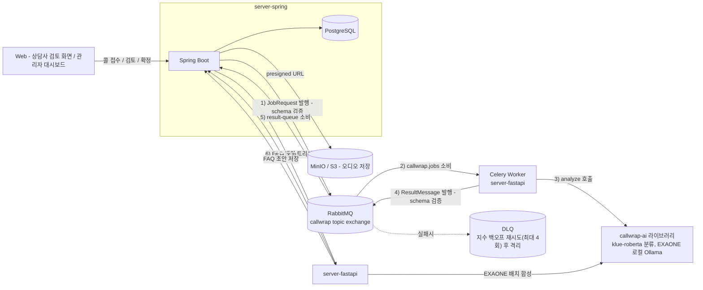

# CallWrap — Backend (server-spring)

장애인활동지원 상담센터의 상담 후처리 업무를 자동화하는 데이터/오케스트레이션 서버입니다.

상담사가 통화 종료 후 수기로 작성하던 요약, 상담 분류, 등급 산정, 후속 조치 여부 판단 등의 과정을 AI 파이프라인이 초안으로 생성합니다. 상담사는 생성된 결과를 검토·수정하여 간편하게 확정할 수 있으며, 반복되는 문의를 모아 FAQ 지식베이스를 자동 축적합니다. 이를 통해 상담사의 반복 업무 부담을 줄이고 상담 데이터를 구조화된 형태로 표준화하는 것을 목표로 합니다.

이 레포지토리는 시스템의 4개 핵심 저장소 중 Backend(Spring Boot) 를 담당합니다. 음성인식, 화자 분리, 분류 및 요약 등의 AI 연산은 직접 수행하지 않으며, 콜 접수, 사용자 인증, 파이프라인 오케스트레이션, 검토 워크플로우, 결과 저장 및 모니터링을 맡고 AI 연산은 server-fastapi에 비동기로 위임합니다.

| 저장소 | 역할 | 스택 |
|---|---|---|
| `server-spring` (이 레포) | 인증, 콜 접수·검토 API, 파이프라인 오케스트레이션, FAQ 검수 API, 상태·결과 영구 저장, 메트릭 노출 | Spring Boot 3.5, Java 21, PostgreSQL |
| `server-fastapi` | Celery 워커 — 전사(STT)·화자분리·품질게이트·AI분석 실행을 오케스트레이션, FAQ 배치 생성 트리거 처리 | FastAPI, Celery, RabbitMQ |
| `AI-model` (`callwrap-ai`) | 실제 AI 연산 라이브러리 — 분류(klue-roberta), 상담등급·요약·후속처리·FAQ필요여부(EXAONE, 로컬 Ollama) | Python 라이브러리, `server-fastapi`가 git 의존성으로 설치 |
| `web` | 상담사 검토 화면, 관리자 대시보드(FAQ 검수 포함) | TypeScript |

## 전체 아키텍처



콜이 접수되면 Spring이 `JobRequest`를 RabbitMQ에 발행하고 즉시 `202 Accepted`를 반환한다. Celery 워커(`server-fastapi`)가 전사→품질게이트→AI분석을 내부에서 전부 처리한 뒤 `ResultMessage`로 최종 결과만 돌려주면, Spring이 상태(`DONE` / `NEEDS_HUMAN_REVIEW` / `FAILED`)에 따라 분기해 저장한다. **Spring은 AI 모델을 직접 호출하지 않는다** — 큐를 사이에 둔 두 서비스가 완전히 비동기로 분리되어 있다.

Celery는 **RabbitMQ를 브로커로만 쓰고 result backend(Redis 등)는 쓰지 않는다.** 태스크 결과는 Celery 자체 메커니즘이 아니라, 각 태스크가 처리를 마친 뒤 직접 `ResultMessage`를 RabbitMQ에 발행하는 방식으로 Spring에 전달된다. 시스템 전체에 Redis는 어디에도 쓰이지 않는다.

### 콜 처리 상태 (6단계)

```
UPLOADED → PROCESSING → DONE / NEEDS_HUMAN_REVIEW / FAILED → CONFIRMED
```

`DONE`·`NEEDS_HUMAN_REVIEW`·`FAILED`는 파이프라인 결과에 따라 갈리고, 상담사가 검토를 마치면 `CONFIRMED`(종결)로 전이한다. `CONFIRMED`와 `FAILED`만 종결 상태다.

## server-spring이 담당하는 것

- **인증·인가** — JWT 발급/재발급/로그아웃, role(COUNSELOR/ADMIN) 기반 화면·API 접근 제어 (`counselor` 도메인)
- **콜 접수** — presigned URL 발급(오디오는 Spring을 거치지 않고 클라이언트가 스토리지에 직접 업로드) 후 `JobRequest` 발행, 즉시 202 반환
- **파이프라인 오케스트레이션** — RabbitMQ를 통한 비동기 Job 발행/결과 수신, 메시지 계약(JSON Schema) 검증, 장애 시 DLQ·재시도
- **검토 워크플로우** — AI 판정 결과 조회, 상담사 수정·확정(`confirm`)
- **FAQ 검수 파이프라인** — FAQ 후보 콜 집계 API 제공, FastAPI에 배치 생성 트리거, 생성된 FAQ 초안 저장·수정·게시·폐기 API 제공
- **상태·결과 영구 저장** — PostgreSQL(Flyway 스키마 관리), 전사·품질검증·AI분석 결과를 JSONB로 저장
- **운영 가시성** — Micrometer/Prometheus로 큐 적재량·처리 지연시간·발행/수신 건수 노출

## 핵심 기능

1. **비동기 파이프라인 오케스트레이션** — RabbitMQ topic exchange(`callwrap`) 기반. 콜 접수는 즉시 202로 응답하고, 실제 처리는 백그라운드에서 이뤄진다.
2. **메시지 계약 검증** — `JobRequest`/`ResultMessage` 둘 다 JSON Schema(Draft-07, `networknt/json-schema-validator`)로 발행 시점과 수신 시점 모두 검증한다. 위반 시 메트릭 카운터를 올리고 요청을 거부한다.
3. **장애 대응(DLQ + 재시도)** — `callwrap.jobs`(Job 큐), Spring의 result 큐 양쪽에 Dead Letter Exchange/Queue를 구성했고, Spring 리스너에는 지수 백오프 재시도(2s → 30s, 최대 4회)가 붙어 있다. 스키마 위반이나 존재하지 않는 콜처럼 재시도해도 해결되지 않는 오류는 `AmqpRejectAndDontRequeueException`으로 표시해 재큐하지 않고 DLQ로 보낸다.

   > 다만 **재시도를 거친 뒤에 DLQ로 간다.** `spring.rabbitmq.listener.simple.retry`가 켜져 있으면 재시도 인터셉터가 예외 종류를 가리지 않고 먼저 4회(약 14초) 돌린 뒤에야 이 예외의 "재큐 금지"가 적용되기 때문이다(실측 확인). 결과적으로 메시지는 정상적으로 격리되지만, ① 못 고칠 메시지가 그 시간만큼 뒤 메시지를 막고 ② `callwrap_result_schema_violation_total`이 **한 건을 네 번 센다.** 즉시 격리가 필요해지면 재시도 인터셉터에 예외 분류기를 붙여야 한다.
4. **콜 검토 워크플로우** — 상담사가 AI 판정을 검토·수정 후 확정한다. 확정 전까지는 자유롭게 수정 가능하고, 확정 이후 데이터는 엔티티 내부 메서드(`AnalysisResult.confirm()`)를 통해서만 바뀐다.
5. **FAQ 자동 생성 (+ 중복 병합 · 추천 정렬)** — "FAQ 반영 필요"(`needs_faq`)로 판정되고 아직 처리되지 않은 콜을 상담분류(소분류) 단위로 묶어 배치 생성을 트리거한다. FastAPI가 EXAONE으로 대표 질문·답변을 합성해 돌려주면, Spring은 같은 소분류 안에서 질문 문장이 비슷한(단어 겹침 비율 Jaccard ≥ 0.5) 기존 `DRAFT`/`PUBLISHED` 항목이 있는지 먼저 찾는다(`FaqEntryService.findMergeTarget()`). 있으면 새로 만들지 않고 그 항목에 근거 콜만 누적하고(`FaqEntry.absorb()`), 없을 때만 새 `DRAFT`를 만든다 — 배치를 돌 때마다 같은 주제의 FAQ가 중복으로 쌓이는 걸 막는다. 이 매칭(소분류 필터 + 문장 유사도 비교)은 "겹치는가 아닌가"만 보면 되는 작업이라 언어 추론이 필요 없다고 보고 LLM을 부르지 않고 코드로 처리하며, EXAONE은 문항 합성에만 쓴다. 목록 조회(`GET /api/faq-entries`)는 근거 콜이 많이 쌓인(=많이 문의된) 순으로 정렬해 반환해서 검수하는 상담사에게 우선순위를 "추천"하는 신호로 쓰고, web은 5건 이상 누적된 항목에 배지를 붙여 보여준다. 반려(`DISCARDED`)된 항목은 병합 대상에서 제외한다 — 상담사가 명시적으로 거절한 걸 배치가 조용히 되살리지 않기 위해서다. 트리거는 두 경로다 — 관리자가 누르는 수동 트리거(`POST /api/faq-entries/generate-batch`)와, `@Scheduled(cron = "0 0 4 * * *")`로 매일 새벽 4시(KST)에 자동 실행되는 `FaqBatchScheduler`. 소분류당 후보 3건 미만이면 그 그룹은 건너뛰고 다음 배치에서 재시도된다.
6. **운영 가시성** — `/actuator/prometheus`에서 큐 적재량(Job 큐·Result 큐 모두, RabbitMQ Management API를 10초 주기로 폴링), Job 발행 건수, 결과 수신 건수(상태별), 처리 소요시간(p50/p95/p99), 스키마 위반 건수를 노출한다. Grafana 대시보드(`observability/grafana/provisioning/`)도 함께 프로비저닝되어 `http://localhost:3001`에서 바로 열린다.
7. **API 문서화** — springdoc-openapi 기반 Swagger UI, JWT bearer 인증 스킴 포함.
8. **부하 테스트** — `loadtest/`에 Locust/k6 기반 시나리오(콜 접수→처리 완료까지의 파이프라인 부하) 준비.
9. **실시간 갱신(SSE)** — 콜 상태가 바뀔 때마다(`PROCESSING`/`DONE`/`NEEDS_HUMAN_REVIEW`/`FAILED`/`CONFIRMED`) `/api/reviews/stream`으로 이벤트를 밀어줘서, 상담사 화면이 폴링 없이 대기열을 갱신한다. `@TransactionalEventListener(AFTER_COMMIT)`로 트랜잭션이 실제로 커밋된 뒤에만 내보낸다.
10. **관리자 대시보드 집계** — 상태별·등급별·유형별 건수와 평균 검토 시간을 `/api/reviews/stats`에서 DB `GROUP BY`/`AVG`로 직접 계산해 반환한다. 목록 API로 콜을 가져와 프론트에서 세는 대신 이 엔드포인트를 쓴다. 시간대별 처리량(`hourlyThroughput`)과 상담사별 악성콜 분포(`maliciousByCounselor`)도 같은 방식으로 계산해 함께 내려준다.
11. **역할 기반 접근 제어(RBAC)** — 상담사는 콜 검토(대기열·후속처리·처리완료)만, 관리자는 모니터링 대시보드(FAQ 검수 포함)만 쓰도록 화면과 API 양쪽에서 완전히 분리한다. 자세한 구조는 아래 "인증 설계" 참고.

## 인증 설계

호출 주체가 둘로 나뉘어 인증 방식도 둘로 나눴다.

- **JWT** (`JwtAuthenticationFilter`) — 상담사가 로그인 후 web에서 호출하는 모든 경로.
  `Authorization: Bearer {token}` 헤더로 인증하며, principal은 `counselorId`(UUID) 하나만 담는다
  (POC 규모에서 `UserDetails` 계층 없이 `@AuthenticationPrincipal UUID`로 바로 받는 게 더 단순하다고 판단).
- **API Key** (`ApiKeyAuthFilter`) — 사람이 아니라 다른 서버가 호출하는 경로. 사회보장정보원 콜 접수
  시스템(`POST /api/reviews`, `POST /api/audio/upload-url`)과 FastAPI 배치 생성기(`/api/internal/faq/**`)가
  해당한다. `X-API-Key` 헤더 값을 스코프(`API_KEY_INTAKE` / `API_KEY_INTERNAL`)로 매핑해, 사보원 키로
  내부 FAQ API를, 반대로 FastAPI 키로 콜 접수 API를 부를 수 없도록 최소 권한을 강제한다. 키 비교는
  `MessageDigest.isEqual`로 상수 시간 비교한다.

두 필터 모두 `SecurityFilterChain`에서 `UsernamePasswordAuthenticationFilter` 앞에 등록되며, "토큰/키가
있으면 인증 컨텍스트를 채우고 없어도 필터 자체는 막지 않는다" — 실제 차단은 `authorizeHttpRequests`의
경로별 규칙이 담당한다. 인증(누가 부르는가)과 인가(무엇을 할 수 있는가)를 필터와 규칙으로 분리한 구조다.

### 역할 기반 접근 제어 (RBAC)

로그인한 상담사는 `role`(`COUNSELOR` / `ADMIN`) 하나로 접근 범위가 완전히 갈린다. 상담사는 콜 검토(대기열·후속처리·처리완료)만, 관리자는 모니터링 대시보드(FAQ 검수 포함)만 쓴다 — 두 역할의 화면은 서로 겹치지 않는다.

- `role`은 로그인 시 JWT 클레임에 실린다(`JwtTokenProvider.createAccessToken`). `refreshToken`에는 넣지 않고, 재발급(`/api/auth/refresh`) 때마다 DB에서 최신 role을 다시 읽어 새 accessToken에 반영한다 — role이 나중에 바뀌어도 만료 전까지 옛 값이 남지 않는다.
- `JwtAuthenticationFilter`가 role을 `GrantedAuthority`로 SecurityContext에 심고, `SecurityConfig`가 이를 근거로 인가한다: FAQ 검수(`/api/faq-entries/**`)와 대시보드 통계(`GET /api/reviews/stats`)는 `ADMIN`만, 검토 확정(`PATCH /api/reviews/{id}/confirm`)은 `COUNSELOR`만 호출 가능하다. 나머지(대기열 조회 등)는 역할 무관하게 로그인만 하면 된다 — 두 역할이 함께 쓰는 인프라이기 때문이다.
- 프론트(`web`)도 같은 role로 사이드바·라우트를 나눠서, 사이드바 링크를 안 보여주는 것을 넘어 주소창 직접 접근도 자기 권한 밖 화면이면 리다이렉트한다. 백엔드 인가 규칙이 최종 방어선이고, 프론트 분리는 UX 차원이다.
- 회원가입 API가 없는 POC 규모라 관리자 계정을 만들 방법이 마땅치 않았다. `DevAccountSeeder`(`ApplicationRunner`)가 앱 기동 시 `admin`/`admin`(ADMIN), `test`/`test`(COUNSELOR) 계정을 자동 생성한다(`existsByLoginId`로 확인 후 없을 때만 생성) — DB 볼륨이 초기화돼도 재기동만 하면 복구된다.

## 기술 스택

- **Java 21 / Spring Boot 3.5** — Web MVC, Validation, Security
- **Spring Data JPA + Flyway** — PostgreSQL 스키마 버전 관리
- **Spring AMQP (RabbitMQ)** — Spring↔FastAPI 비동기 메시징, DLQ·재시도
- **networknt json-schema-validator** — 메시지 계약(JSON Schema) 검증
- **JWT (jjwt)** — 상담사 인증
- **springdoc-openapi** — API 문서화 (`/swagger-ui.html`)
- **Micrometer + Prometheus** — 운영 메트릭 노출 (`/actuator/prometheus`)
- **AWS SDK v2 (S3Presigner)** — 오디오 업로드용 presigned URL 발급

## API 요약

| Method | Endpoint | 설명 | 인증 |
|---|---|---|---|
| POST | `/api/auth/login` | 상담사 로그인 | - |
| POST | `/api/auth/refresh` | 액세스 토큰 재발급 | - |
| POST | `/api/auth/logout` | 로그아웃 | - |
| GET | `/api/users/me` | 로그인한 상담사 정보 조회 | JWT |
| POST | `/api/audio/upload-url` | 오디오 업로드용 presigned URL 발급 | API Key(사보원) |
| POST | `/api/reviews` | 콜 접수 — 즉시 202 반환, 분석은 비동기로 트리거 | API Key(사보원) |
| GET | `/api/reviews` | 검토 목록 조회 (상태 필터, 페이지네이션) | JWT |
| GET | `/api/reviews/{reviewId}` | 검토 상세 조회 | JWT |
| GET | `/api/reviews/stats` | 관리자 대시보드 집계 (상태·등급·유형별 건수, 평균 검토 시간, 시간대별 처리량, 상담사별 악성콜 분포) | JWT(ADMIN) |
| GET | `/api/reviews/stream` | 콜 상태 변경 실시간 스트림 (SSE) | JWT |
| PATCH | `/api/reviews/{reviewId}/confirm` | 검토 확정 | JWT(COUNSELOR) |
| POST | `/api/faq-entries/generate-batch` | FAQ 배치 생성 트리거 (수동, 새벽 4시 자동 실행도 동일 로직) | JWT(ADMIN) |
| GET | `/api/faq-entries` | FAQ 목록 조회 (상태 필터) | JWT(ADMIN) |
| PATCH | `/api/faq-entries/{id}` | FAQ 초안 수정 | JWT(ADMIN) |
| POST | `/api/faq-entries/{id}/publish` | FAQ 게시 | JWT(ADMIN) |
| POST | `/api/faq-entries/{id}/discard` | FAQ 폐기 | JWT(ADMIN) |
| GET | `/api/internal/faq/candidates` | FAQ 후보 콜 조회 (FastAPI 전용) | API Key(내부) |
| POST | `/api/internal/faq/entries` | FAQ 초안 등록 (FastAPI 전용) | API Key(내부) |

로컬 실행 후 `http://localhost:8080/swagger-ui.html`에서 전체 스펙을 확인할 수 있다.

## 설계 원칙

- **도메인 분리** — `counselor`(인증) / `review`(콜·검토) / `transcript`(전사) / `qualitycheck`(품질게이트 결과) / `analysis`(AI 분석 결과) / `faq`(FAQ 초안·검수) 를 ERD 테이블과 1:1로 대응하는 패키지로 나눴다. 여러 도메인을 가로지르는 오케스트레이션은 `pipeline` 패키지에만 둔다.
- **단일 책임** — `review` 도메인 안에서도 생성(`ReviewCreateService`)·조회(`ReviewQueryService`)·확정(`ReviewConfirmService`)을 별도 클래스로 분리했다. `faq` 도메인도 후보 집계(`FaqCandidateService`)·배치 트리거(`FaqBatchTriggerService`)·초안 관리(`FaqEntryService`)를 나눴다.
- **불변식은 엔티티가 스스로 지킨다** — `AnalysisResult.confirm()`을 통해서만 확정 정보가 채워지고, `Call.transitionTo()`를 통해서만 상태가 바뀌고, `FaqEntry.publish()`/`discard()`를 통해서만 FAQ 상태가 바뀐다.
- **메시지 계약을 코드가 강제한다** — JobRequest/ResultMessage 모두 JSON Schema로 검증하고, 위반 시 예외를 던지고 메트릭을 남긴다. 스키마 파일(`schema/*.schema.json`)이 곧 계약 문서다.
- **부분 실패를 허용한다** — AI 판정 중 일부(등급·분류 등)가 확신도 부족이나 모델 오류로 실패해도 나머지 결과는 그대로 상담사에게 전달한다. 실패한 항목만 `failures`에 표시되고 전체 분석이 막히지 않는다.
- **대용량 조회 경로 최적화**
  - JPA `open-in-view: false`, batch insert/update(`hibernate.jdbc.batch_size`) 설정
  - `calls.status`, `analysis_results`의 JSONB 값(`consultation_type`, `grade` 등)에 표현식 인덱스 적용
  - `Call.counselorId`는 연관관계 대신 원시 UUID로 보관 — 목록/상세 조회에서 불필요한 조인·N+1을 원천 차단
  - 목록 조회는 전사·분석 JSONB 전체를 가져오지 않고 요약 DTO로만 페이지네이션
  - 조회 전용 서비스는 전부 `@Transactional(readOnly = true)`

## 패키지 구조

```
com.callwrap
├── global          # 설정, 보안(JWT), 예외 처리, 공통 타입(BaseTimeEntity, Judgment<T>)
├── counselor       # 상담사 도메인 — 인증 / 내 정보
├── review          # 콜(calls) 도메인 — 검토 생성 / 조회 / 확정
├── transcript      # 전사 결과 도메인
├── qualitycheck    # 품질 게이트 결과 도메인
├── analysis        # AI 분석 결과 도메인
├── faq             # FAQ 후보 집계 / 초안 관리 / 검수 API
├── audio           # 오디오 업로드용 presigned URL 발급
└── pipeline        # RabbitMQ 오케스트레이션, 메시지 계약 검증, 운영 메트릭
    ├── messaging     # JobRequest/ResultMessage 발행·수신, DLQ 설정
    ├── messaging/validation  # JSON Schema 기반 계약 검증
    ├── metrics       # 큐 적재량 · 처리 지연시간 · 발행/수신 건수
    └── service       # Job 디스패치 / 결과 처리
```


## 로컬 실행

```bash
docker compose up -d          # PostgreSQL 16 + RabbitMQ 3-management
./gradlew bootRun --args='--spring.profiles.active=local'
```

Spring 앱은 도커 안이 아니라 호스트에서 `./gradlew bootRun`으로 직접 뜨는 구조라, MinIO는 `localhost:9000`으로 바라본다.

| 서비스 | 접속 정보 |
|---|---|
| API | http://localhost:8080 |
| Swagger UI | http://localhost:8080/swagger-ui.html |
| RabbitMQ 관리 콘솔 | http://localhost:15672 (guest/guest) |

계정은 따로 회원가입할 필요 없이 앱이 처음 뜰 때 자동으로 만들어진다(`DevAccountSeeder`) —
`admin`/`admin`(관리자), `test`/`test`(상담사). 이미 있으면 건드리지 않는다.

필요 환경변수:

| 변수 | 설명 |
|---|---|
| `JWT_SECRET` | JWT 서명 키 (32바이트 이상 랜덤 문자열) |
| `FASTAPI_BASE_URL` | FAQ 배치 생성 트리거 호출 대상 (기본값 `http://localhost:8001`) |
| `CALLWRAP_API_KEY_INTAKE` | 사회보장정보원 콜 접수 시스템 인증용 (`X-API-Key`) |
| `CALLWRAP_API_KEY_INTERNAL` | FastAPI 배치 생성기 인증용 (`X-API-Key`). `server-fastapi`의 `SPRING_INTERNAL_API_KEY`와 동일해야 함 |

