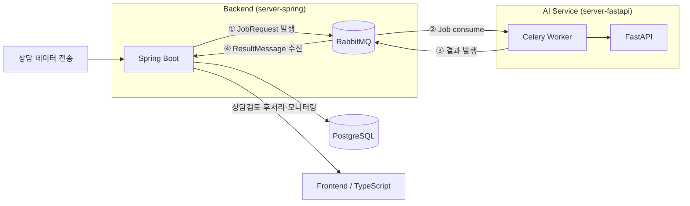

# CallWrap — Backend (server-spring)

한국사회보장정보원 산학협력 POC **CallWrap**의 데이터/오케스트레이션 서버.
상담 콜 후처리(전사·품질검증·AI분석) 파이프라인을 조율하고, 상담사 인증과 검토 워크플로우를 제공한다.

이 레포는 3개 서비스로 분리된 시스템 중 **Backend(Spring Boot)** 를 담당한다. AI 모델 호출(STT·화자분리·분류·요약)은 이 레포가 직접 수행하지 않고 `server-fastapi`에 위임한다.

| 레포 | 역할 | 스택 |
|---|---|---|
| `server-spring` (이 레포) | 인증, 콜 접수/검토 API, 파이프라인 오케스트레이션, 상태·결과 저장 | Spring Boot 3.5, Java 21 |
| `server-fastapi` | STT·화자분리·품질게이트·AI분석 실행 | FastAPI, Celery |
| `web` | 상담사 검토 화면, 관리자 대시보드 | TypeScript |

## 아키텍처



콜이 접수되면 Spring이 `JobRequest`를 RabbitMQ에 발행하고 즉시 202를 반환한다. FastAPI가 전사→품질게이트→AI분석을 내부에서 전부 처리한 뒤 `ResultMessage`로 최종 결과만 돌려주면, Spring이 그 결과를 상태(`DONE` / `NEEDS_HUMAN_REVIEW` / `FAILED`)에 따라 분기·저장한다. Spring은 AI 모델을 직접 호출하지 않는다.

## 기술 스택

- **Java 21 / Spring Boot 3.5** — Web MVC, Validation, Security
- **Spring Data JPA + Flyway** — PostgreSQL 스키마 버전 관리
- **Spring AMQP (RabbitMQ)** — Spring↔FastAPI 비동기 메시징
- **JWT (jjwt)** — 상담사 인증
- **springdoc-openapi** — API 문서화(`/swagger-ui.html`)
- **Micrometer + Prometheus** — 운영 메트릭 노출 (`/actuator/prometheus`)

## API

| Method | Endpoint | 설명 |
|---|---|---|
| POST | `/api/auth/login` | 상담사 로그인 |
| POST | `/api/auth/refresh` | 액세스 토큰 재발급 |
| POST | `/api/auth/logout` | 로그아웃 |
| GET | `/api/users/me` | 로그인한 상담사 정보 조회 |
| POST | `/api/reviews` | 콜 접수 — 즉시 202 반환, 분석은 비동기로 트리거 |
| GET | `/api/reviews` | 검토 목록 조회 (상태 필터, 페이지네이션) |
| GET | `/api/reviews/{reviewId}` | 검토 상세 조회 |
| PATCH | `/api/reviews/{reviewId}/confirm` | 검토 확정 |

로컬 실행 후 `http://localhost:8080/swagger-ui.html`에서 전체 스펙을 확인할 수 있다.

## 설계 원칙

- **도메인 분리** — `counselor`(인증) / `review`(콜·검토) / `transcript`(전사) / `qualitycheck`(품질게이트 결과) / `analysis`(AI 분석 결과)를 ERD 테이블과 1:1로 대응하는 패키지로 나눴다. 여러 도메인을 가로지르는 오케스트레이션은 `pipeline` 패키지에만 둔다.
- **단일 책임** — `review` 도메인 안에서도 생성(`ReviewCreateService`)·조회(`ReviewQueryService`)·확정(`ReviewConfirmService`)을 별도 클래스로 분리했다.
- **불변식은 엔티티가 스스로 지킨다** — 예: `AnalysisResult.confirm()`을 통해서만 확정 정보가 채워지고, `Call.transitionTo()`를 통해서만 상태가 바뀐다.
- **대용량 조회 경로 최적화**
  - JPA `open-in-view: false`, batch insert/update(`hibernate.jdbc.batch_size`) 설정
  - `calls.status`, `analysis_results`의 JSONB 값(`consultation_type`, `grade`)에 표현식 인덱스 적용
  - `Call.counselorId`는 연관관계 대신 원시 UUID로 보관 — 목록/상세 조회에서 불필요한 조인·N+1을 원천 차단
  - 목록 조회는 전사·분석 JSONB 전체를 가져오지 않고 요약 DTO로만 페이지네이션
  - 조회 전용 서비스는 전부 `@Transactional(readOnly = true)`

## 패키지 구조

```
com.callwrap
├── global          # 설정, 보안(JWT), 예외 처리, 공통 타입(BaseTimeEntity, Judgment<T>)
├── counselor       # 상담사 도메인 — 인증 / 내 정보
├── review          # 콜(calls) 도메인 — 검토 생성 / 조회 / 확정
├── transcript      # 전사 결과 도메인
├── qualitycheck    # 품질 게이트 결과 도메인
├── analysis        # AI 분석 결과 도메인
└── pipeline        # RabbitMQ 오케스트레이션 (JobRequest 발행 / ResultMessage 수신)
```

## 로컬 실행

```bash
docker compose up -d          # PostgreSQL 16 + RabbitMQ 3-management
./gradlew bootRun --args='--spring.profiles.active=local'
```

| 서비스 | 접속 정보 |
|---|---|
| API | http://localhost:8080 |
| Swagger UI | http://localhost:8080/swagger-ui.html |
| RabbitMQ 관리 콘솔 | http://localhost:15672 (guest/guest) |

필요 환경변수:

| 변수 | 설명 |
|---|---|
| `JWT_SECRET` | JWT 서명 키 (32바이트 이상 랜덤 문자열) |

## 알려진 제한사항

- `needs_faq` 판단을 담당할 FastAPI 엔드포인트 미확정
- 로그아웃 시 refreshToken 서버측 폐기(블랙리스트) 미구현 — 현재는 쿠키 무효화만 수행
- 콜 접수 API의 시스템 간 인증(API Key) 미구현
- Spring↔FastAPI 메시지 계약(JobRequest/ResultMessage)에 대한 스키마 검증·`call_id` 멱등 처리·DLQ/재시도 정책은 별도 이슈로 진행 중
